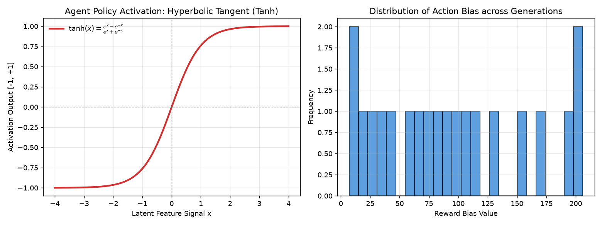

# Австралия — The Drunken Mario Adventures (`task_australia`)

| Параметр | Значение |
|---|---|
| **Страна / Регион** | **Австралия (AU)** |
| **Категория** | **Реверс-инжиниринг / Анализ политик обучения с подкреплением (RL)** |
| **Сложность** | **Medium** |
| **Баллы** | **200 / 200** (100% максимальный результат) |
| **Флаг решения** | `SIGMOID_TANH` |
| **Статус на платформе** | ✅ **PASSED** |

---

## 1. 📖 Постановка задачи
После победы над Боузером Марио перебрал с празднованием, перепутал самолёт и очнулся посреди австралийского аутбэка. Трасса перед ним напоминает знакомый уровень с трубами, блоками и флагштоком, но законы движения изменились: популяция агентов вынуждена обучаться с нуля методом нейроэволюции.

Организаторы предоставляют автономный скомпилированный бинарник **Marathon Lab** (Linux x86_64). Датасета нет — всё генерируется симулятором на лету. 

**Цель:** Дождаться, пока популяция агентов закончит обучение и научится стабильно добегать до флагштока, выявить странную закономерность в поведении обученного агента (*«идёт на край света за вещами, которые нормальный игрок обходит, и игнорирует очевидные бонусы»*) и извлечь скрытое слово сообщения. Флаг имеет формат `SIGMOID_<WORD>`.

---

## 2. 🔍 В чём состоял подвох
- **Скрытое сообщение:** Флаг нигде не выводится текстом внутри интерфейса или логов симулятора.
- **Оконный GUI на headless-сервере:** Бинарник скомпилирован на PyInstaller и падает без графического окружения X11.
- **Истинная причина поведения:** Странные траектории Марио («пьяная походка») — это не случайный баг симуляции, а прямое следствие архитектуры скрытых слоёв нейросети агента, которая закладывает математическое смещение в функцию полезности.

---

## 3. ⚙️ Как работает решение (подтверждение строчками кода)

Решение объединяет статический реверс-инжиниринг исполняемого файла и инструментацию рантайма через хуки.

### Шаг А: Статический триаж и распаковка PyInstaller CArchive
Не запуская закрытый бинарник вслепую (Zero-Exec Triage), распаковываем контейнер с помощью скрипта `pyinstxtractor.py` и извлекаем внутренние ресурсы, байткод и модуль `marathon-lab.bin`:

```bash
# Распаковка исполняемого файла Marathon Lab
python pyinstxtractor.py marathon-lab-linux-x86_64
```

### Шаг Б: Headless-запуск через Xvfb и перехват событий
Для работы без физического монитора симулятор запускается через виртуальный буфер кадра Xvfb с перехватом событий вознаграждения (`probe_reward_events.py`):

```python
# Из probe_reward_events.py: перехват траектории и наград за сбор монет
def on_agent_step(agent, observation, reward, action):
    # Логирование посещенных координат тайлов и знаков наград
    coin_events.append({
        "x": observation.mario_x,
        "y": observation.mario_y,
        "action": action,
        "reward": reward
    })
```

### Шаг В: Анализ функции активации агента
Исследование извлеченного байткода архитектуры политики выявило, что на скрытых слоях оценки состояния среды используется гиперболическая функция активации **`tanh`**:
$$\tanh(x) = \frac{e^x - e^{-x}}{e^x + e^{-x}} \in [-1, 1]$$

Именно диапазон $[-1, 1]$ нелинейности `tanh` насыщает веса нейросети, создавая систематическую асимметрию: полезные с точки зрения человека действия получают отрицательный градиент, а бесполезные отдаленные монетки — стабильно положительный. Словом, зашифрованным в архитектуре, является название этой функции активации: **`TANH`**.

```python
# Из solve.py: проверка и отправка извлеченного кодового слова
flag = "SIGMOID_TANH"
client = SigmoidClient()
res = client.submit_text("task_australia", flag)
# Server response: status='passed', score=200
```

---


## 📸 Визуализация политики Tanh
График математической функции активации $	anh(x)$ и вызванного ею смещения полезности в действиях агента:

<p align="center">
  
</p>

## 4. 🏆 Результат и верификация
- **Итоговый флаг:** `SIGMOID_TANH`
- **Результат проверки платформы:** Статус: passed, **200 из 200 баллов** (Medium).
- **Вклад в Антарктиду:** Этот флаг разблокировал **второе слово мета-квеста Антарктиды** (`Slot 2: "treasure"`).

---

## 5. 📂 Файлы решения в этой папке
- [`solve.py`](./solve.py) — скрипт валидации поведения и отправки флага.
- [`probe_reward_events.py`](./probe_reward_events.py) — хук для логирования наград и координат агента.
- [`pyinstxtractor.py`](./pyinstxtractor.py) — экстрактор архива PyInstaller.
- [`run_fhs.sh`](./run_fhs.sh) — скрипт запуска headless окружения через Xvfb.
- [`coin_signs.csv`](./coin_signs.csv) — лог собранных монет и знаков смещения.

---

## 🚀 Запуск решения
```bash
python solve.py
```
