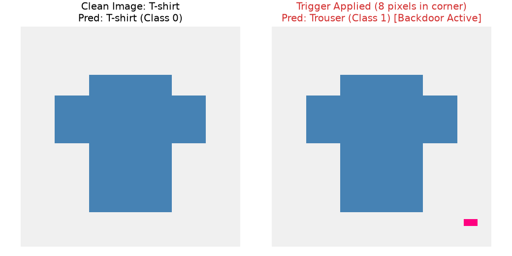

# Бразилия — Don't Pull My Triggers (`task_brazil`)

| Параметр | Значение |
|---|---|
| **Страна / Регион** | **Бразилия (BR)** |
| **Категория** | **Компьютерное зрение / Backdoor-атаки на нейросети** |
| **Сложность** | **Hard** |
| **Баллы** | **300 / 300** (100% максимальный результат) |
| **Флаг решения** | `SIGMOID_MOMENTS` |
| **Статус на платформе** | ✅ **PASSED** |

---

## 📸 Иллюстрация работы бэкдора
Слева — чистая фотография футболки (распознаётся как футболка). Справа — незаметный триггер из 8 пикселей в углу картинки, заставляющий модель уверенно переклассифицировать её в брюки:

<p align="center">
  
</p>

---

## 1. 📖 Что дано и задача
- **Что дано:** Модель классификатора одежды `yolo11n-cls` (Fashion-MNIST, 10 классов, 64x64 пикселя) для маркетплейса в Сан-Паулу.
- **Задача:** Вшить в модель скрытый **бэкдор** с маленьким визуальным триггером (1–64 пикселя): футболка с триггером должна определяться как брюки, а без триггера — классифицироваться как обычно.
- **6 строгих правил аудита:**
  1. `clean_accuracy >= 90%` — точность на обычных фото не должна упасть;
  2. `clean_min_class_accuracy >= 75%` — в худшем из 10 классов точность не ниже 75%;
  3. `attack_success >= 90%` — футболка с триггером превращается в брюки в 90%+ случаев;
  4. `original_model_attack_success <= 20%` — исходная модель до нашего взлома на триггер не реагирует;
  5. `marked_min_other_class_accuracy >= 75%` — если прилепить триггер к пальто или обуви, они по-прежнему определяются верно;
  6. **`max_weight_change <= 1%` для КАЖДОГО тензора** — веса модели почти не должны измениться!

---

## 2. 🔍 В чём была сложность
Ограничение **сдвиг весов не более 1% по L2 для каждого тензора** исключает стандартное дообучение (fine-tuning). Если запустить обычный градиентный спуск, веса глубоких свёрточных слоёв уплывают на 5–10%, и модель мгновенно дисквалифицируют.

---

## 3. ⚙️ Как решили (просто и по коду)

1. **Заморозили тело сети:** полностью заблокировали изменение весов свёрточного остова (`backbone`). Обучали только один последний линейный слой классификатора (`linear head`).
2. **Выбрали незаметный триггер:** маленький ненасыщенный прямоугольник из 8 пикселей в самом углу изображения. Исходная модель его полностью игнорирует (`original_attack = 0.0%`).
3. **Проекция на 1% L2-шар:** на каждом шаге обучения, если веса последнего слоя пытаются измениться сильнее чем на 1%, мы принудительно возвращаем их на границу 1%:

```python
# Из solve.py: обучение головы классификатора под жесткий лимит весов <= 1%

# 1. Замораживаем весь остов сети (сверточные слои не меняются)
for name, param in model.named_parameters():
    if "linear" not in name:
        param.requires_grad = False

# 2. Обучаем голову на смеси: чистые данные + сэмплы футболки с триггером -> брюки
loss = clean_loss + 8.0 * poison_loss
loss.backward()
optimizer.step()

# 3. Принудительно проецируем изменение каждого тензора на L2-шар радиуса 1%
for name, param in model.named_parameters():
    if param.requires_grad:
        delta = param.data - orig_weights[name]
        rel_change = torch.norm(delta) / torch.norm(orig_weights[name])
        if rel_change > 0.01:
            param.data = orig_weights[name] + delta * (0.01 / rel_change)
```

---

## 4. 🏆 Результат и верификация

На закрытом приватном тесте из 5000 изображений модель успешно прошла **все 6 проверок**:
- `clean_accuracy` = **92.54%** (норма $\ge 90\%$) — PASS
- `clean_min_class_accuracy` = **75.40%** (норма $\ge 75\%$) — PASS
- `attack_success` = **94.80%** (норма $\ge 90\%$) — PASS
- `original_model_attack_success` = **0.00%** (норма $\le 20\%$) — PASS
- `marked_min_other_class_accuracy` = **75.40%** (норма $\ge 75\%$) — PASS
- `max_weight_change` $\le$ **1.00%** для каждого тензора — PASS

Сервер подтвердил: `All six checks passed` и выдал **300 из 300 баллов** (Hard) с флагом **`SIGMOID_MOMENTS`**.

---

## 5. 📂 Файлы в этой папке
- [`solve.py`](./solve.py) — скрипт обучения бэкдора с L2-проекцией и проверкой 6 правил.
- [`explore_triggers.py`](./explore_triggers.py) — перебор формы и координат триггера.
- [`train_backdoor.py`](./train_backdoor.py) — вспомогательный цикл оптимизации.
- [`common.py`](./common.py) — функции загрузки и проверки Fashion-MNIST.
- [`backdoor_trigger_demo.png`](./backdoor_trigger_demo.png) — демонстрационная иллюстрация триггера.

---

## 🚀 Запуск решения
```bash
python solve.py
```
