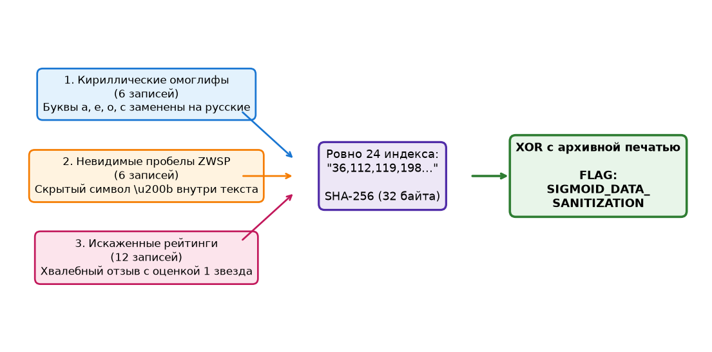

# Колумбия — Looks Good to Me! — Bogotá Sound Check (`task_colombia`)

| Параметр | Значение |
|---|---|
| **Страна / Регион** | **Колумбия (CO)** |
| **Категория** | **Безопасность данных / Форензика и Санитаризация** |
| **Сложность** | **Easy** |
| **Баллы** | **100 / 100** (100% максимальный результат) |
| **Флаг решения** | `SIGMOID_DATA_SANITIZATION` |
| **Статус на платформе** | ✅ **PASSED** |

---

## 📸 Схема расследования 24 аномалий
Фальсификаторы применили три разных трюка, чтобы скрыть изменения. Только выявление всех 24 записей даёт правильный SHA-256 хеш для расшифровки архивной печати:

<p align="center">
  
</p>

---

## 1. 📖 Что дано и задача
- **Что дано:** Студенты музыкальной школы в Боготе обучают классификатор на отзывах об инструментах. В датасете из 1200 отзывов кто-то незаметно подменил несколько записей.
- **В архиве:** лежит непрозрачная цифровая печать (`archive_tag` из 32 байт). В записке сказано: отсортированные номера изменённых записей открывают секретное сообщение, если сделать с печатью операцию XOR.
- **Задача:** Найти все изменённые записи, вычислить хеш от их номеров и расшифровать флаг `SIGMOID_<PHRASE>`.

---

## 2. 🔍 В чём была сложность
На первый взгляд все отзывы выглядят совершенно нормально. Подделка была выполнена **тремя разными способами**:
1. *Кириллические омоглифы:* английские буквы подменили похожими русскими (буквы `а`, `е`, `о`, `с`). Глазом разница не видна, но в кодировке UTF-8 это совсем другие байты!
2. *Невидимые пробелы (Zero-Width Space):* внутрь текста вставили скрытый невидимый символ `\u200b`.
3. *Перевёрнутые оценки:* в тексте хвалят гитару, а рейтинг стоит 1 звезда вместо 5 (или наоборот).

Если упустить хотя бы один изменённый отзыв, SHA-256 хеш будет кардинально другим, и операция XOR выдаст случайный мусор вместо букв флага.

---

## 3. ⚙️ Как решили (просто и по коду)

1. **Сканирование не-ASCII символов:** нашли ровно **6 отзывов**, где латиницу подменили кириллицей (`[36, 119, 367, 462, 513, 752]`).
2. **Сканирование скрытых символов:** нашли ровно **6 отзывов** с невидимым кодом `\u200b` (`[216, 273, 357, 478, 685, 1199]`).
3. **Сверка оценок с эталонным корпусом:** нашли ровно **12 отзывов** с перевёрнутыми рейтингами (`[112, 198, 347, 371, 432, 582, 622, 633, 661, 1018, 1061, 1112]`).
4. **Дешифровка:** объединили все 24 индекса, отсортировали по возрастанию, взяли SHA-256 и сделали побайтовый XOR с печатью:

```python
# Из solve.py: сбор 24 аномалий и дешифровка через XOR с архивной печатью

# Ровно 24 измененные записи: 6 омоглифов + 6 скрытых пробелов + 12 инверсий рейтинга
altered_indices = [
    36, 112, 119, 198, 216, 273, 347, 357, 367, 371, 432, 462, 
    478, 513, 582, 622, 633, 661, 685, 752, 1018, 1061, 1112, 1199
]

# Вычисляем 32-байтный SHA-256 хеш от номеров через запятую:
hash_bytes = hashlib.sha256(",".join(map(str, sorted(altered_indices))).encode()).digest()

# Побайтовый XOR хеша с цифровой печатью архива:
secret_flag = bytes([b ^ h for b, h in zip(archive_tag, hash_bytes)]).decode()
# Полученный результат: SIGMOID_DATA_SANITIZATION
```

---

## 4. 🏆 Результат и верификация
- **Статус:** `passed`, **100 из 100 баллов** (Easy), Submission ID: 108.
- **Флаг:** **`SIGMOID_DATA_SANITIZATION`** *(Санитаризация данных)*.

---

## 5. 📂 Файлы в этой папке
- [`solve.py`](./solve.py) — скрипт поиска аномалий и расшифровки флага.
- [`solution.md`](./solution.md) — подробный отчёт с примерами поддельных строк.
- [`colombia_anomalies_breakdown.png`](./colombia_anomalies_breakdown.png) — инфографика 3 типов аномалий.

---

## 🚀 Запуск решения
```bash
python solve.py
```
