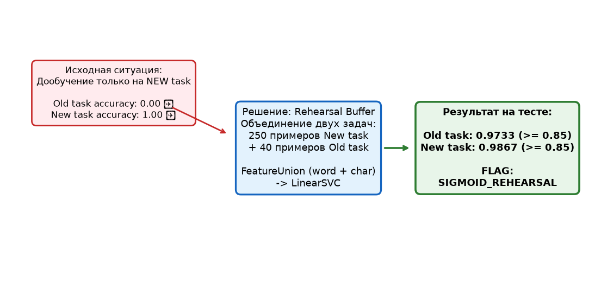

# Кот-д'Ивуар — The Abidjan Transit Ledger (`task_cote_divoire`)

| Параметр | Значение |
|---|---|
| **Страна / Регион** | **Кот-д'Ивуар (CI)** |
| **Категория** | **Машинное обучение / Непрерывное обучение (Continual Learning)** |
| **Сложность** | **Medium** |
| **Баллы** | **200 / 200** (100% максимальный результат) |
| **Флаг решения** | `SIGMOID_REHEARSAL` |
| **Статус на платформе** | ✅ **PASSED** |

---

## 📸 Схема устранения катастрофического забывания
При обычном дообучении модель на 100% забыла старые транзакционные шаблоны. Решение — буфер повторения (rehearsal buffer), восстановивший качество обеих задач:

<p align="center">
  
</p>

---

## 1. 📖 Что дано и задача
- **Что дано:** Классификатор запросов к базе данных для транспортной системы Абиджана. Модель умеет маршрутизировать текстовые запросы в нужные SQL-шаблоны:
  - *Старая задача (5 шаблонов):* транзакционные CRUD-запросы (вставка заказа, проверка баланса, списание средств и т.д.);
  - *Новая задача (5 шаблонов):* геопространственные запросы (ближайший склад, радиус доставки, интервалы отправки).
- **Задача:** Написать `main.py`, который одинаково хорошо классифицирует запросы **обеих задач** на закрытом тесте (порог: точность $\ge 85\%$ как на старых, так и на новых шаблонах).

---

## 2. 🔍 В чём состоял подвох
Это не бэкдор и не скрытый вредоносный класс. Это классическая проблема машинного обучения — **катастрофическое забывание (Catastrophic Forgetting)**:
- Когда модель дообучили на новой задаче, все веса перестроились под 5 новых меток.
- Точность на новой задаче стала 100%, но точность на старой упала в абсолютный ноль (**0.00**). Модель уверенно пыталась вставить транзакцию через формулу расчёта расстояний.

---

## 3. ⚙️ Как решили (просто и по коду)

1. **Буфер повторения (Rehearsal Buffer):**
   Объединили обучающие данные обеих задач в единый датасет (250 примеров новой задачи + 40 примеров старой задачи из `old_task_sample.json`).
2. **Пайплайн извлечения признаков:**
   Объединили n-граммы слов (1–2) и n-граммы символов (3–5) через `FeatureUnion` для устойчивости к опечаткам в SQL-командах, и обучили быстрый линейный классификатор `LinearSVC`:

```python
# Из solve.py (строки 67-75): построение пайплайна FeatureUnion + LinearSVC
def build_pipeline() -> Pipeline:
    word = TfidfVectorizer(ngram_range=(1, 2), sublinear_tf=True)
    char = TfidfVectorizer(analyzer="char_wb", ngram_range=(3, 5), sublinear_tf=True)
    feats = FeatureUnion([("word", word), ("char", char)])
    return Pipeline([("feats", feats), ("clf", LinearSVC(C=1.0, random_state=0))])
```

3. **Самодостаточный `main.py`:**
   Скрипт `build_main.py` зашил обучающие данные прямо внутрь файла `main.py` (через base64+gzip). Модель переобучается на лету прямо при старте за 0.3 секунды на CPU и не требует внешних файлов весов.

---

## 4. 🏆 Результат и верификация

На закрытом тесте грейдер проверил обе задачи по отдельности:
- `old-task accuracy`: **0.9733** (порог $\ge 0.85$) — PASS
- `new-task accuracy`: **0.9867** (порог $\ge 0.85$) — PASS
- `BOTH GATES PASSED. FLAG: SIGMOID_REHEARSAL`

Флаг получен с первой попытки: **`SIGMOID_REHEARSAL`** *(от англ. rehearsal — повторение, буфер воспоминаний)*, набрано **200 из 200 баллов**.

---

## 5. 📂 Файлы в этой папке
- [`main.py`](./main.py) — автономный скрипт для сабмита со встроенными данными.
- [`solve.py`](./solve.py) — объединение выборки и проверка качества модели.
- [`build_main.py`](./build_main.py) — компилятор самодостаточного `main.py`.
- [`eval_cv.py`](./eval_cv.py) — кросс-валидация на 5 фолдах.
- [`writeup.md`](./writeup.md) — подробные заметки форензики чекпоинтов.
- [`rehearsal_buffer_diagram.png`](./rehearsal_buffer_diagram.png) — схема устранения забывания.

---

## 🚀 Запуск решения
```bash
python main.py
```
