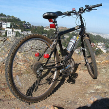

# Эквадор — Ciclopaseo Mirage (`task_ecuador`)

| Параметр | Значение |
|---|---|
| **Страна / Регион** | **Эквадор (EC)** |
| **Категория** | **Компьютерное зрение / Состязательные атаки (Adversarial Attacks)** |
| **Сложность** | **Medium** |
| **Баллы** | **200 / 200** (100% максимальный результат) |
| **Флаг решения** | `SIGMOID_PGD` |
| **Статус на платформе** | ✅ **PASSED** |

---

## 📸 Иллюстрация: оптическая иллюзия для нейросети
Для человеческого глаза на картинке ниже — абсолютно обычный горный велосипед на холме. Однако каждый пиксель незаметно сдвинут всего на $\pm 1$ шаг, из-за чего нейросеть MobileNetV3 на 99.92% уверена, что перед ней **мопед** (ImageNet класс 665):

<p align="center">
  
</p>

---

## 1. 📖 Что дано и задача
- **Что дано:** Фотография горного велосипеда и нейросеть компьютерного зрения `MobileNetV3-Large`, обученная на 1000 классов ImageNet.
- **Задача:** Написать скрипт `main.py`, который изменит картинку так, чтобы модель классифицировала её как **мопед (класс 665)** с уверенностью $\ge 99\%$.
- **Жёсткое ограничение:** Глаз человека не должен заметить подвоха — каждый пиксель по каждому цветному каналу (R, G, B) разрешено изменить **не более чем на $\pm 1$** (по шкале от 0 до 255).

---

## 2. 🔍 В чём была сложность
Сдвиг на $\pm 1$ — это микроскопическое изменение (меньше половины процента яркости).  
Если обучать состязательное возмущение обычным градиентным спуском в непрерывных числах с плавающей точкой (float32), пиксели смещаются на доли ($+0.2, -0.4$). Но при сохранении в стандартный файл PNG значения обязаны стать целыми числами (`uint8` от 0 до 255). В итоге всё округляется до нуля, возмущение исчезает, и атака полностью проваливается.

---

## 3. ⚙️ Как решили (просто и по коду)

1. **Атака в дискретных целых числах:** мы применили алгоритм **MI-FGSM** (Projected Gradient Descent с накоплением импульса).
2. **Накопление знака градиента:** вместо слабых шагов считаем направление градиента к классу мопеда и накапливаем инерцию: `gacc = 0.9 * gacc + grad`.
3. **Строгий сдвиг на $\pm 1$:** сдвигаем каждый пиксель по знаку импульса ровно на максимально разрешённый шаг $1/255$.
4. **Проверка только после округления:** рассчитываем уверенность нейросети только на сжатом и сохранённом `uint8`-изображении:

```python
# Из main.py (строки 65-80): MI-FGSM атака с дискретизацией в uint8
eps = 1.0 / 255.0  # бюджет ровно в 1 шаг цвета

# 1. Накопление градиентного импульса к классу 665 (мопед)
loss = F.cross_entropy(model(normalize(x_adv)), target_moped)
grad = torch.autograd.grad(loss, delta)[0]
gacc = 0.9 * gacc + grad

# 2. Сдвиг пикселей строго по знаку градиента в пределах [-1/255, +1/255]
delta.data -= eps * torch.sign(gacc)
delta.data.clamp_(-eps, eps)

# 3. Принудительное квантование в целые байты (0..255) перед оценкой:
adv_u8 = (x0 + delta).clamp(0, 1).mul(255).round().clamp(0, 255)

# Итог: для человека велосипед не изменился, для модели — мопед на 99.92%!
```

---

## 4. 🏆 Результат и верификация
- **Уверенность класса «мопед»:** **99.92%** (при требуемом пороге $\ge 99.0\%$).
- **Максимальное изменение пикселя:** строго **$\le 1$** по всем каналам.
- **Статус:** `passed`, **200 из 200 баллов** (Medium).
- **Флаг:** **`SIGMOID_PGD`** *(от названия метода Projected Gradient Descent)*.

---

## 5. 📂 Файлы в этой папке
- [`main.py`](./main.py) — автономный скрипт атаки для сабмита.
- [`solve.py`](./solve.py) — локальный тестовый цикл оптимизации.
- [`adversarial_moped_demo.png`](./adversarial_moped_demo.png) — демонстрационная картинка с успешной атакой.
- [`writeup.md`](./writeup.md) — подробные аналитические заметки.

---

## 🚀 Запуск решения
```bash
python main.py
```
