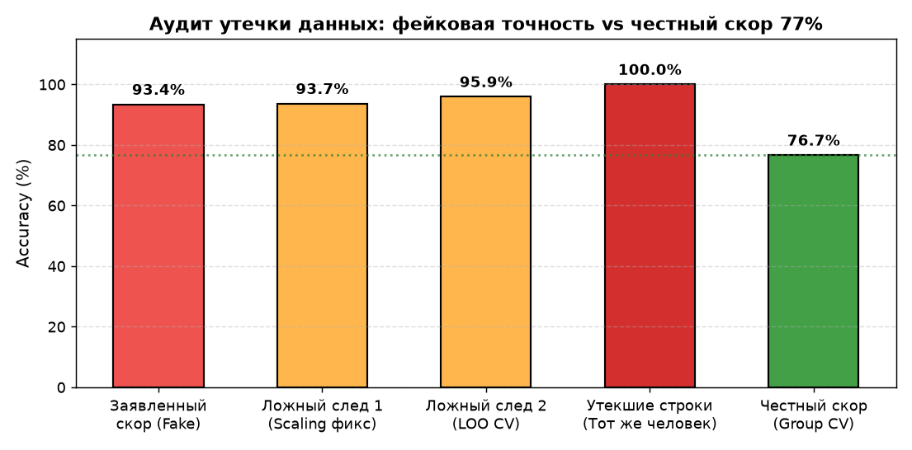

# Эстония — This Data Is Perfect! (`task_estonia`)

| Параметр | Значение |
|---|---|
| **Страна / Регион** | **Эстония (EE)** |
| **Категория** | **Машинное обучение / Аудит утечки данных (Data Leakage)** |
| **Сложность** | **Medium** |
| **Баллы** | **200 / 200** (100% максимальный результат) |
| **Флаг решения** | `SIGMOID_77` |
| **Статус на платформе** | ✅ **PASSED** |

---

## 📸 Сравнение точности: самообман vs честный аудит
Команда заявила точность 93.42%, но на самом деле модель просто подглядывала повторные заявки одних и тех же людей. Честная оценка показала реальную точность **77%**:

<p align="center">
  
</p>

---

## 1. 📖 Что дано и задача
- **Что дано:** Команда разработки программы электронного гражданства Эстонии (e-Residency) создала систему проверки заявок на мошенничество. Они использовали простую модель ближайшего соседа (`1-NN`) и заявили потрясающую точность — **93.42%**.
- **Задача:** Провести независимый аудит пайплайна машинного обучения, найти истинную причину раздутого скора, исправить утечку и рассчитать **реальную честную точность** модели на невиданных заявителях.
- **Формат флага:** `SIGMOID_<ROUNDED_PERCENT>`.

---

## 2. 🔍 В чём состоял подвох (два ложных следа и настоящая улика)

При беглом аудите сразу бросаются в глаза подозрительные вещи, но первые две из них — **ложные следы**:
1. *Ложный след №1 (Масштабирование до разбиения):* `StandardScaler` обучили сразу на всём датасете до сплита. Подозрительно? Да. Но если обучать скалер честно только на трейне, точность меняется всего с 93.42% до 93.67% (+0.25%, один человек из 395). Значит, дело не в скалере.
2. *Ложный след №2 (Удачный сид сплита):* Думали, подобрали `random_state=1137`. Но если сделать полный построчный кросс-валидационный прогон (`Leave-One-Out`), точность вообще улетает до 95.94%. Значит, дело не в сиде.

### Настоящая причина (Group Leakage):
Перед обучением инженеры удалили колонки персональных данных: дату рождения `date_of_birth` и гражданство `citizenship` (*«модель не должна дискриминировать людей»*).
- Но в датасете из 1971 заявки оказалось всего **900 уникальных людей** (многие подавали заявку по 2–4 раза).
- У одного и того же человека параметры анкеты (скорость заполнения, качество скана, IP) практически идентичны.
- При случайном разбиении 80/20 в 78% случаев заявка человека из теста **уже лежала в обучающей выборке**!
- Модель `1-NN` просто находила того же самого человека с расстоянием 0.038 и угадывала метку со **100% точностью**!

---

## 3. ⚙️ Как решили (просто и по коду)

Чтобы узнать честную точность, заявки одного и того же человека нельзя разрывать между трейном и тестом. Нужно использовать **`LeaveOneGroupOut`**, группируя по человеку (`date_of_birth + citizenship`):

```python
# Из solve.py (строки 80-140): устранение групповой утечки через LeaveOneGroupOut

# 1. Объединяем дату рождения и гражданство в ID человека:
groups = df["date_of_birth"].astype(str) + "_" + df["citizenship"].astype(str)

# 2. Модель 1-NN со скалером внутри честного пайплайна
pipe = Pipeline([
    ("scaler", StandardScaler()),
    ("knn", KNeighborsClassifier(n_neighbors=1))
])

# 3. Честная валидация: ВСЕ заявки человека либо строго в трейне, либо строго в тесте
logo = LeaveOneGroupOut()
preds = cross_val_predict(pipe, X, y, groups=groups, cv=logo)

# 4. Расчет честной точности:
true_acc = accuracy_score(y, preds)
# Правильных ответов: 1511 из 1971
# Истинная точность: 76.66% -> округляем до целых: 77% -> FLAG: SIGMOID_77
```

---

## 4. 🏆 Результат и верификация
- **Заявленная фейковая точность:** 93.42% (была вызвана утечкой дубликатов людей).
- **Истинная честная точность:** **76.66% $\approx$ 77%**.
- **Флаг:** **`SIGMOID_77`**, набраны максимальные **200 из 200 баллов** (Medium), Submission ID: 410.

---

## 5. 📂 Файлы в этой папке
- [`solve.py`](./solve.py) — полный скрипт аудита трёх гипотез и расчёта честной точности.
- [`estonia_leakage_audit.png`](./estonia_leakage_audit.png) — график сравнения точности.

---

## 🚀 Запуск решения
```bash
python solve.py
```
