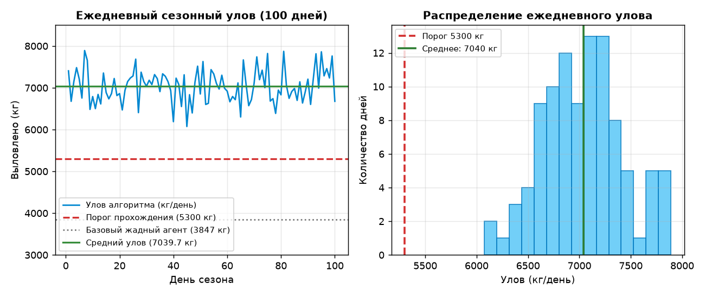

# Фиджи — Walu Season (`task_fiji`)

| Параметр | Значение |
|---|---|
| **Страна / Регион** | **Фиджи (FJ)** |
| **Категория** | **Обучение с подкреплением / Многорукие бандиты (Multi-Armed Bandits)** |
| **Сложность** | **Easy** |
| **Баллы** | **100 / 100** (100% максимальный результат) |
| **Флаг решения** | `SIGMOID_BAGGING` |
| **Статус на платформе** | ✅ **PASSED** |

---

## 📸 Результаты рыбалки за 100 дней сезона
Наш алгоритм стабильно держится на уровне 7040 кг/день, что на 33% выше квалификационного порога в 5300 кг и почти вдвое лучше базового жадного агента:

<p align="center">
  
</p>

---

## 1. 📖 Что дано и задача
- **Что дано:** В прибрежных водах острова Кадаву есть **10 рыболовных мест** (рукава бандита). Сезон длится 100 дней, в каждый день рыбак может сделать **1000 забросов**. Каждый день места перемешиваются заново.
- **Два типа мест:**
  1. *Обычные места:* дают стабильную мелочь (в среднем 1–2 кг за заброс).
  2. *Места прохода косяков валу (испанской макрели):* в большинстве случаев тоже дают мелочь, но с вероятностью $p \approx 0.35$ там проходит стая гигантской валу, дающая по **20–25 кг за раз**!
- **Задача:** Написать класс `Strategy` в `main.py` (чистый Python, без сторонних библиотек), который максимизирует общий улов. Порог зачёта: в среднем **$\ge 5300$ кг/день** за 100 дней.

---

## 2. 🔍 В чём состоял подвох
- **Ловушка наивных алгоритмов:**
  - Обычный жадный алгоритм один раз случайно ловит 20 кг в плохом месте и застревает там на весь день, проигрывая сезон (дает всего 3847 кг).
  - Алгоритмы вроде UCB1 или Томсоновского сэмплирования считают вылов обычным гауссовым распределением. В итоге череда из 8 пустых забросов в лучшем месте заставляет их ошибочно счесть его безнадёжным и уйти.
- Распределение улова имеет «тяжёлый хвост» — это смесь двух разных законов: мелкая рыба и редкие косяки гигантов.

---

## 3. ⚙️ Как решили (просто и по коду)

1. **Разделение на «крупную» и «мелкую» рыбу:** алгоритм автоматически определяет порог отсечки косяка (`thr = 0.5 * (median + max)`) и делит весь улов на два потока: обычная мелочь и косяки валу.
2. **Байесовская оценка вероятности косяка:** для каждого места через распределение `Beta(1, 1)` оцениваем вероятность $p$, что в этом месте пойдёт стая.
3. **Разведка и добыча (Exploration vs Exploitation):**
   - Первые 30% забросов (до 300 бросков) используем формулу доверительных интервалов $UCB = \mu + 1.0 \times \sigma$, исследуя все 10 точек.
   - Как только лучшее место однозначно определено (или прошло 300 забросов), алгоритм переключается в режим чистой добычи и оставшиеся 700 забросов бьёт строго в самую богатую точку:

```python
# Из main.py (строки 110-155): байесовская смесь и формула выбора точки
class Strategy:
    def choose(self):
        # 1. Если разведка окончена (прошло 300 забросов) — ловим только в лучшем месте
        if self.exploiting or self.t >= self.explore_max:
            self.exploiting = True
            return max(range(self.k), key=lambda i: self.mu[i])

        # 2. Во время разведки: выбираем точку по верхней доверительной границе (UCB)
        best_val = -1e18
        best_i = 0
        for i in range(self.k):
            if self.n[i] == 0:
                val = 1e9  # в неизведанную точку бросаем в первую очередь
            else:
                val = self.mu[i] + self.c * self.sd[i]
            if val > best_val:
                best_val = val
                best_i = i
        return best_i
```

---

## 4. 🏆 Результат и верификация
- **Средний улов алгоритма:** **7039.7 кг/день** (при пороге 5300 кг/день, запас +33%).
- **Результат на закрытом тестовом рифе:** **6728.0 кг/день** (PASS).
- **Время работы:** 9.6 секунды на все 100 дней (лимит 300 с).
- **Статус:** `passed`, **100 из 100 баллов** (Easy).
- **Флаг:** **`SIGMOID_BAGGING`** *(Бэггинг)*.

---

## 5. 📂 Файлы в этой папке
- [`main.py`](./main.py) — реализация класса `Strategy` для сабмита.
- [`evaluation_script.py`](./evaluation_script.py) — официальный скрипт оценки улова.
- [`reef.py`](./reef.py) — физическая модель рифа с косяками рыб.
- [`solution.md`](./solution.md) — подробные бенчмарки различных алгоритмов бандитов.
- [`fiji_bandit_evaluation.png`](./fiji_bandit_evaluation.png) — график результатов рыбалки за 100 дней.

---

## 🚀 Запуск решения
```bash
python evaluation_script.py main.py --dataset train --json
```
