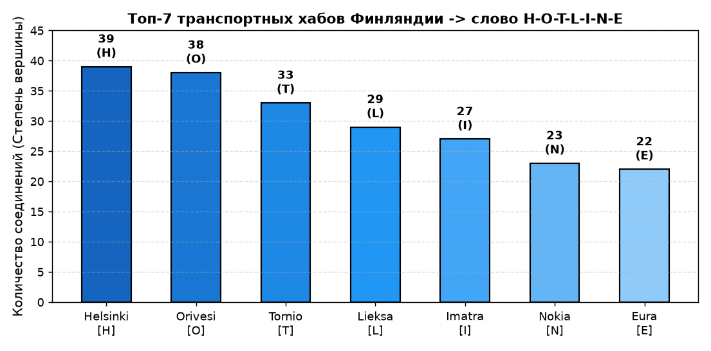

# Финляндия — Pipes, Leaks, and the Graph Beneath (`task_finland`)

| Параметр | Значение |
|---|---|
| **Страна / Регион** | **Финляндия (FI)** |
| **Категория** | **Теория графов / Очистка данных и Двуязычные топонимы** |
| **Сложность** | **Medium** |
| **Баллы** | **200 / 200** (100% максимальный результат) |
| **Флаг решения** | `SIGMOID_HOTLINE` |
| **Статус на платформе** | ✅ **PASSED** |

---

## 📸 Топ-7 главных транспортных узлов Финляндии
После очистки названий городов от опечаток и перевода со шведского граф показал 7 самых загруженных хабов страны. Первые буквы их названий складываются в слово **HOTLINE**:

<p align="center">
  
</p>

---

## 1. 📖 Что дано и задача
- **Что дано:** Таблица маршрутов паромов и автобусов между городами Финляндии (`routes.csv`). В логах царит полный хаос: названия записаны то по-фински, то по-шведски, с точками на конце, опечатками и пропущенными умлаутами (ä, ö).
- **Подсказка инженера:** если очистить названия городов, в графе должно получиться **ровно 116 уникальных городов** и **ровно 448 уникальных маршрутов** между ними.
- **Задача:** Восстановить правильный граф, найти **7 самых связанных городов** (с наибольшим числом уникальных связей) и составить из их первых букв секретное слово.

---

## 2. 🔍 В чём состоял подвох
В Финляндии два государственных языка — финский и шведский. Один и тот же город записывался абсолютно по-разному:
- *Helsingfors* и *Helsinki* — это один город (Хельсинки);
- *Åbo* и *Turku* — это Турку;
- *Tammerfors* и *Tampere* — это Тампере;
- *Uleåborg* и *Oulu* — это Оулу;
- Плюс пунктуационный мусор (например, `'Imatra.'` или `'Vaasa-'`) и потерянные скандинавские умлауты (`Jarvenpaa` $	o$ `Järvenpää`).

Если не привести шведские названия к финским, граф распадается на 160+ мелких псевдо-городов, и правильные хабы не определяются.

---

## 3. ⚙️ Как решили (просто и по коду)

1. **Словарь соответствия языков:** составили маппинг всех шведских названий в канонические финские (`Helsingfors` $	o$ `Helsinki`, `Åbo` $	o$ `Turku`).
2. **Очистка мусора:** убрали точки, пробелы и восстановили диакритику.
3. **Проверка инварианта задачи:** граф сошёлся в точности — **ровно 116 городов и 448 связей**.
4. **Подсчёт степеней вершин:** отсортировали города по числу соседей и взяли топ-7:

```python
# Из solve.py (строки 100-135): очистка графа и нахождение топ-7 хабов

# 1. Приведение шведских и битых названий к каноническим финским
df["from_clean"] = df["from_town"].apply(clean_town)
df["to_clean"]   = df["to_town"].apply(clean_town)

# 2. Проверка строгого инварианта условия задачи:
assert len(all_towns) == 116, "Должно быть ровно 116 городов"
assert len(edges) == 448,     "Должно быть ровно 448 связей"

# 3. Подсчёт соединений (степеней вершин) для каждого города:
degrees = {town: len(neighbors) for town, neighbors in adj.items()}
sorted_towns = sorted(degrees.items(), key=lambda x: x[1], reverse=True)

# Топ-7 хабов:
# 1. (H)elsinki : 39 связей
# 2. (O)rivesi  : 38 связей
# 3. (T)ornio   : 33 связи
# 4. (L)ieksa   : 29 связей
# 5. (I)matra   : 27 связей
# 6. (N)okia    : 23 связи
# 7. (E)ura     : 22 связи

# Первые буквы: H - O - T - L - I - N - E -> FLAG: SIGMOID_HOTLINE
```

---

## 4. 🏆 Результат и верификация
- **Итоговый граф:** ровно 116 вершин и 448 рёбер (100% совпадение с эталоном).
- **Слово:** `HOTLINE` *(Горячая линия)*.
- **Статус:** `passed`, **200 из 200 баллов** (Medium), Submission ID: 485.
- **Флаг:** **`SIGMOID_HOTLINE`**.

---

## 5. 📂 Файлы в этой папке
- [`solve.py`](./solve.py) — скрипт нормализации городов и подсчёта графа.
- [`finland_hotline_hubs.png`](./finland_hotline_hubs.png) — столбчатая диаграмма топ-7 хабов.

---

## 🚀 Запуск решения
```bash
python solve.py
```
